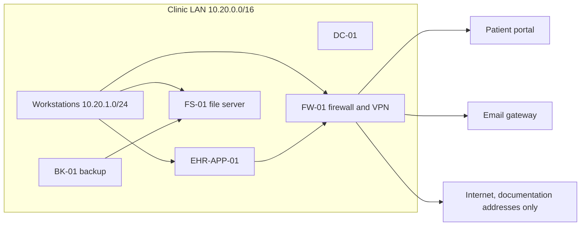
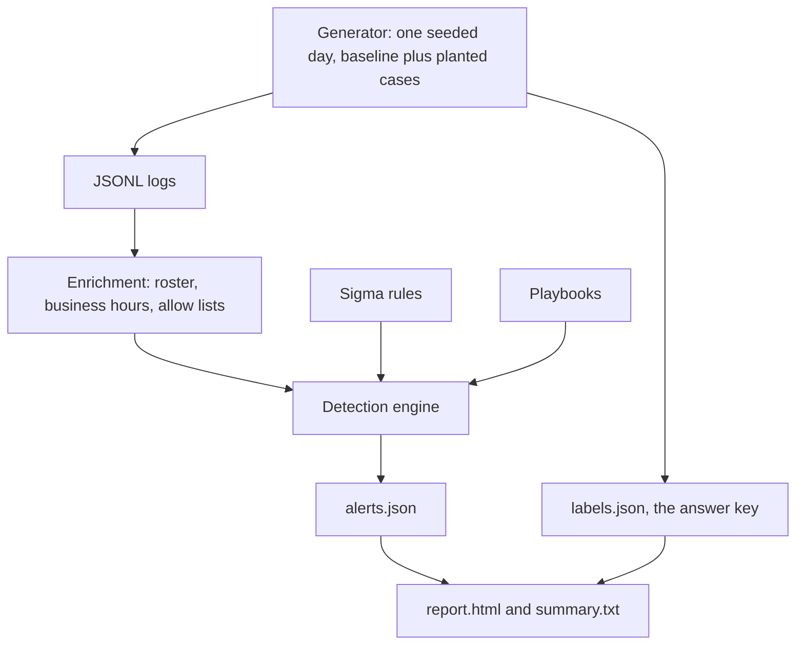

# Clinic detection practice pack

A small clinic generates the same kinds of logs a hospital does, and almost none of the staff to read them. This project is a local practice pack for that job: one synthetic day at a made-up clinic, detections for the things that actually go wrong there, and a short note on what a four-person response looks like.

The clinic is fictional. The patients are not patients. Logs say that a chart was opened. They do not contain a chart. Every address outside the clinic LAN is in a documentation range (RFC 5737). Nothing here calls a paid API or a cloud service.

Maintained by Sangeeta Sinha, VigilAI Solutions. She has run clinic operations and holds Security+, CySA+, and CEH.

## The problem

Riverside Family Clinic, for this exercise, has a front desk, a medical assistant, a nurse, a clinician, a billing clerk, an office manager, and a part-time IT person. The systems that matter are:

- Windows PCs and three servers (domain controller, the CedarChart EHR application, a file server), plus a backup box
- CedarChart, which records who opened which chart
- a patient portal with its own sign-in log
- a firewall that is also the VPN
- an email gateway

A normal Thursday is logons, charting, claims, appointment mail, and a backup at 1 a.m. The sample day also has three planted problems, because a detection with nothing to find is not a test:

1. Overnight, one address tries many portal passwords and then gets in.
2. After lunch, a macro attachment is delivered to the front desk. The workstation then runs encoded PowerShell, picks up the EHR service account, opens a remote desktop on the file server, turns off recovery, exports charts, emails a csv to personal webmail, uploads a large file, and clears the Security log.
3. After close, the billing account connects to the VPN from a country the clinic does not use and reads clinical notes. Billing's job is claims, not notes.

Ordinary work is in the same files: the on-call nurse charts in the evening, IT takes a remote desktop during the day, the backup job lists shadow copies, a patient mistypes one password, the office manager exports a single chart for a records request, and the EHR vendor update is large and expected. Those should stay quiet. The tests check both sides.

## Architecture





The engine never reads `labels.json`. The report does, and only to show whether each planted case produced the alert it should. A live clinic would not have that file.

## How to run

Needs Python 3.11 or newer. The only library is PyYAML.

```bash
python3 -m venv .venv
source .venv/bin/activate
pip install -e ".[dev]"
clinic-soc run
pytest -q
```

`clinic-soc run` writes:

| Path | What it is |
| --- | --- |
| `out/logs/*.jsonl` | The day's logs |
| `out/labels.json` | Planted cases. Not an input to detection. |
| `out/alerts.json` | Alerts, with evidence samples and the playbook text |
| `out/report.html` | Alerts, a timeline, ATT&CK coverage, and the planted-case scorecard |
| `out/summary.txt` | The same counts, for the terminal |

Open `out/report.html` in a browser. It does not load anything from the network.

Other commands, if you want the steps separate:

```bash
clinic-soc generate --out out
clinic-soc detect --logs out/logs --out out/alerts.json
clinic-soc report --alerts out/alerts.json --labels out/labels.json --logs out/logs --out out/report.html
```

`--seed` defaults to 42. The same seed reproduces the same logs. A different seed shuffles which synthetic MRNs are touched. The counts that the rules care about stay the same.

`make test` and `make run` do the same thing without installing the package. They set `PYTHONPATH=src`.

## What the rules look for

| Rule | What it is | ATT&CK |
| --- | --- | --- |
| `portal_credential_stuffing` | Many distinct portal usernames failing from one address | T1110.004 Credential Stuffing |
| `portal_success_after_stuffing` | A sign-in from that same address within 30 minutes | T1078 Valid Accounts |
| `email_macro_delivered` | A macro or script attachment the gateway actually delivered | T1566.001 Spearphishing Attachment |
| `win_encoded_powershell` | `powershell.exe` started with an encoded command | T1059.001 PowerShell |
| `win_local_admin_added` | A member added to local Administrators | T1098 Account Manipulation |
| `win_service_account_from_workstation` | `svc.ehr` or `svc.backup` used from a clinical PC | T1021.002, T1078.002 |
| `win_rdp_to_server` | Remote desktop to a server by anyone other than IT | T1021.001 Remote Desktop Protocol |
| `win_inhibit_recovery` | Shadow copies deleted, or Windows recovery turned off | T1490 Inhibit System Recovery |
| `fw_large_outbound` | More than 100 MB uploaded to an address that is not the vendor update server | T1048 Exfiltration Over Alternative Protocol |
| `email_export_to_webmail` | A large csv, spreadsheet, or zip sent to personal webmail | T1567 Exfiltration Over Web Service |
| `ehr_bulk_export` | One account exported many patients' records in an hour | T1005 Data from Local System |
| `ehr_minimum_necessary` | A record type the job is not allowed to use. Low severity. | T1213 Data from Information Repositories |
| `ehr_minimum_necessary_bulk` | The same miss, across many patients | T1213 |
| `ehr_after_hours_bulk_view` | Many clinical charts after close, and the person is not on call | T1213 |
| `vpn_untrusted_country` | A successful VPN session from a country not on the list | T1133 External Remote Services, T1078 |
| `win_security_log_cleared` | Windows Security log cleared (event 1102) | T1070.001 Clear Windows Event Logs |

ATT&CK often lists one technique under more than one tactic. The report shows the tactic this case is using.

Each alert has a severity, a short triage note, a HIPAA note, a few matching log lines, and a playbook. The playbooks name who to call at this clinic (office manager Avery Brooks, IT Sam Patel, privacy and security lead Sangeeta Sinha), what to unplug or disable, and what to keep. They also say when a lawyer has to decide whether patients are notified. They are an operations checklist. They are not legal advice.

The HIPAA notes point at the sections a clinic actually reads with counsel:

- 45 CFR 164.308(a)(1)(ii)(D), review of information system activity
- 45 CFR 164.312(b), audit controls
- 45 CFR 164.502(b), minimum necessary
- 45 CFR 164.402, the breach definition and the four-factor assessment
- 45 CFR 164.404, 164.406, and 164.408, notices to individuals, the media, and HHS

Minimum necessary is enforced from the roster in `config/clinic.yaml`. Front desk may use scheduling and demographics. Billing may use claims, insurance, and demographics. Clinical notes are for the nurse and the clinician. IT does not get chart content unless the audit row is break-glass with a ticket. The office manager's one-patient records release is marked `patient_release` and is excluded.

Business hours are Monday to Friday, 7:00 a.m. to 7:00 p.m. America/Chicago. 7:00 p.m. is already after hours. Priya Shah is the on-call nurse on the sample day, so her evening charting does not trip the after-hours rule.

## Design choices

The rules are YAML in the Sigma shape: `logsource`, `detection`, `condition`, `level`, `tags`. A small engine runs a subset of that language locally. A full Sigma deployment wants a SIEM. This clinic does not have one, and the pack had to run on a laptop with no extra services. The subset is documented at the top of `src/clinic_soc/sigma.py`. The one deliberate extension is `count(distinct field)`. Upstream Sigma would write that as a correlation. It is the difference between credential stuffing and one patient who forgot a password.

Fields the raw log does not know are added in a separate enrichment step, not trusted if they already appear on the event. After-hours, on-call, "this role may see this record," webmail, VPN country, and the egress allow list are computed from `config/clinic.yaml` and the timestamp. The tests include a pass with enrichment turned off, to show those rules go quiet when the join has not run.

String compares are case-insensitive. Windows command lines and account names do not arrive in one case.

Aggregate rules emit one alert per burst, not one alert per failed password. The evidence sample is capped. The alert still says how many events matched.

Thresholds are set so the planted cases cross them and the planted benign cases do not. They are starting numbers for this file, not numbers to copy onto a production sensor without a week of that clinic's own logs.

External addresses are documentation ranges only, so the sample cannot point at a real network by accident.

## Limitations

- This is a batch over files. It does not tail a live log, and it will not page anyone.
- The sample day is thinned to representative activity. A real Thursday has more of the boring events and, with any luck, none of the planted ones.
- Thresholds, the workstation subnet `10.20.1.`, and the server names are this clinic's. Another site has to edit the rules and the config together.
- `count(distinct ...)` and the `correlation` block will not copy unchanged into every Sigma backend. The `join` key is named that way because a bare `on:` in YAML is a boolean.
- The after-hours rule ignores the on-call roster. A stolen on-call account can read charts at 10 p.m. without firing that rule. The minimum-necessary rule still applies if the account's job does not include notes.
- There is no rule for password spraying against the Windows domain. The portal was the password-guessing path in this pack.
- Command-line rules are string matches. A script whose text merely contains `vssadmin delete shadows` can match. The backup job in the sample lists shadows and starts a backup, and those do not match. Encoded PowerShell is detected by the flag, not by decoding the blob. Do not paste that blob into a website to decode it.
- The VPN rule trusts a country field. The generator fills it in. A real firewall's geo lookup is sometimes wrong, and the playbook says to call the person before disabling them.
- Role checks follow the roster, not the appointment book. A nurse can open a chart for a patient they have no visit with, and this pack will not say so.
- Clearing the Security log hides earlier Windows events. The pack cannot invent them back. The EHR audit and the firewall log are separate and, in the sample, still there.
- Nothing here decides that a breach occurred. The playbooks stop at the point where counsel and the insurer have to.

## Tests

`pytest` checks every rule with at least one true positive and one false positive, then runs the whole day. The day test fails if a planted case is missed, if a benign stand-in fires (IT's remote desktop, the vendor update, the on-call nurse, the quarantined macro, the backup job, a single patient-release export), or if any address falls outside the clinic LAN and the documentation ranges. Generation with the same seed must match byte for byte.

## Layout

```
config/clinic.yaml     roster, hours, allow lists
rules/                 Sigma rules
playbooks/             what to do for each rule
src/clinic_soc/        generator, enrichment, engine, report
tests/                 true/false cases and the full day
out/                   created when you run, not committed
```

## License

MIT. Copyright 2026 Sangeeta Sinha.
